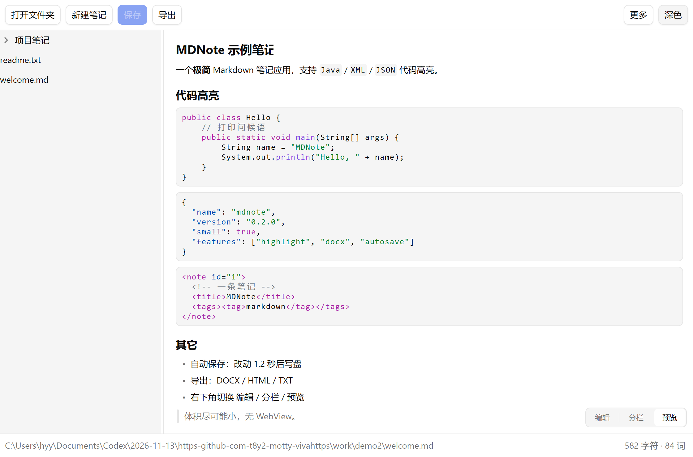
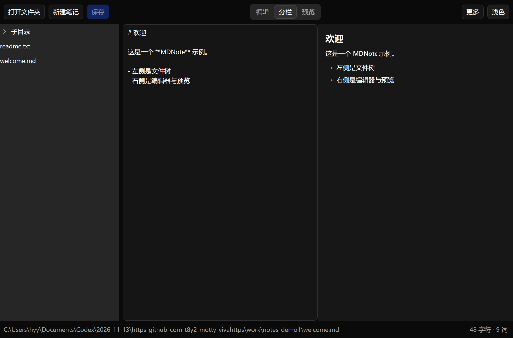

# MDNote — 极简 Markdown 笔记应用

一个用 [Viva](https://github.com/vivaui/viva)（Go 编写的 GPU 原生桌面 UI 框架，**不使用 WebView**）开发的
Markdown 笔记应用。界面与交互参考 [motty](https://github.com/t8y2/motty)，
功能形态参考 [mkdown-site](https://github.com/gggaiitx/mkdown-site)，但**以体积尽可能小为目标**：
最终发布版单文件可执行程序约 **5.5 MB**，无运行时依赖、无 Electron、无 WebView。

## 下载

已构建好的二进制在 [Releases](https://github.com/renpengkai/mdnote/releases/latest)：

| 平台 | 文件 |
| --- | --- |
| macOS · Apple Silicon（M 系列） | `mdnote-0.1.0-darwin-arm64.zip` |
| macOS · Intel | `mdnote-0.1.0-darwin-amd64.zip` |
| Windows x64 | `mdnote.exe` |
| Linux x64 | `mdnote` |

macOS 未签名，首次打开需要去掉隔离标记：

```sh
xattr -dr com.apple.quarantine MDNote.app
```

（或右键 `MDNote.app` → 打开 → 弹窗里再点「打开」。）

## 界面预览

浅色 · 预览模式：



深色 · 分栏模式：



（以上为无头渲染截图，用于展示布局；真实窗口使用系统字体引擎，字形略有差异。）

## 功能

- **文件夹 + 文件树**：打开一个文件夹，左侧列出其中的 Markdown/文本文件（文件夹优先、按名排序，可折叠）。
- **三种视图**：`编辑`（纯源码）/ `分栏`（左源码右预览）/ `预览`（纯渲染）。
- **Markdown 渲染**：标题、粗体、列表、引用、代码块等，随主题配色。
- **保存**：`Ctrl+S` 原子写入（写临时文件再重命名），状态栏实时显示未保存状态。
- **新建 / 重命名 / 删除**：工具栏「新建笔记」与「更多」菜单，删除前二次确认。
- **明暗主题**：工具栏一键切换（深色 / 浅色）。
- **目录监听**：外部改动文件夹时自动刷新文件树。
- **状态栏**：显示当前文件路径、字符数 / 词数、未保存提示。
- 命令行可传入文件或文件夹直接打开：`mdnote.exe <路径>`。

## 快捷键

| 快捷键 | 作用 |
| --- | --- |
| `Ctrl+S` | 保存当前笔记 |
| `Ctrl+O` | 打开文件夹 |
| `Ctrl+N` | 新建笔记 |

## 构建

需要 Go 1.26+。

```sh
go build -trimpath -ldflags='-s -w -buildid=' -o mdnote.exe .
```

`-trimpath` 去掉本地路径，`-s -w` 去掉符号表与调试信息，`-buildid=` 去掉构建 ID，
三者共同把体积压到最小。产物为单个 `mdnote.exe`（约 5.5 MB），可直接分发。

调试构建（保留符号、便于排查）：

```sh
go build -o mdnote-dev.exe .
```

## 编译 macOS 版本

> **重要**：Viva 的 macOS 后端通过 **cgo** 调用 Cocoa / Metal（Objective-C），
> **无法在 Windows / Linux 上交叉编译**——`viva build --target darwin` 会直接报
> `building for darwin needs a macOS host: the Metal bridge is Objective-C and cannot be cross-compiled`。
> 因此 Mac 版必须在 macOS 主机上编译，并需要 Xcode 命令行工具（`xcode-select --install`）。

### 方式一：在 Mac 上直接构建

```sh
sh build-macos.sh
```

或手动：

```sh
go build -trimpath -ldflags='-s -w -buildid=' -o mdnote .          # 裸可执行文件
go build -o viva github.com/vivaui/viva/cmd/viva                    # viva 打包工具
./viva package --target darwin --format zip                         # 生成 MDNote.app
```

产物在 `build/`：`build/mdnote`（裸可执行文件）与 `build/MDNote.app`（应用包）。
`viva.toml` 的 `[mac]` 段设置了 `min_system = "12.0"` 与
`category = "public.app-category.productivity"`。

### 方式二：用 GitHub Actions 自动构建（无需 Mac）

仓库已带 `.github/workflows/build.yml`：推到 GitHub 后，Actions 会在**真实的 macOS
runner** 上编译并上传可下载的产物：

- `mdnote-macos-arm64` — Apple Silicon（`macos-15`）
- `mdnote-macos-amd64` — Intel（`macos-15-intel`）
- `mdnote-windows-amd64` / `mdnote-linux-amd64`

在 Actions 页面选择对应 run，下载 Artifact 即可得到 `MDNote.app`（zip 包）。
注意 `macos-14` / `macos-13` 已被 GitHub 退役，用了会直接取消或永远排队。

### 说明

- 未签名的 `.app` 首次打开会被 Gatekeeper 拦截：右键 → 打开，或执行
  `xattr -dr com.apple.quarantine MDNote.app`。
- 正式分发需 Apple 开发者证书签名与公证：
  `./viva package --target darwin --sign-identity "Developer ID Application: ..."`。
- 本项目在 Windows 上开发，**macOS 二进制由 GitHub Actions 在真实 macOS runner 上产出**
  （Windows 环境无 macOS SDK / clang，无法交叉编译）。

## 测试

```sh
go test ./... -count=1   # 6 个单元测试
go vet ./...             # 静态检查
```

`headless.go` 是构建标签 `vivahead` 下的无头测试入口，**不会进入发布版**：

```sh
go build -tags vivahead -o mdnote-headless.exe .
VIVA_HEADLESS=1 ./mdnote-headless.exe <文件夹>
```

它用参考字体度量做布局，无需 GPU / 字体服务，可在 CI 或无显示环境里跑
`layout` / `expect` / `click` / `shot` 等命令做端到端校验。

## 文件结构

| 文件 | 说明 |
| --- | --- |
| `main.go` | 应用主体：页面、工具栏、文件树、编辑器 / 预览、状态栏、对话框、快捷键 |
| `files.go` | 文件系统辅助：目录扫描、笔记扩展名过滤、原子写入、恢复上次打开 |
| `main_test.go` | 单元测试（打开、保存、主题、新建对话框、扫描、原子写入） |
| `headless.go` | `vivahead` 标签下的无头测试入口（仅测试用） |
| `viva.toml` | 应用元信息、关联文件类型、`[mac]` 打包设置 |
| `build-macos.sh` | 在 macOS 上一键构建 `.app` 的脚本 |
| `.github/workflows/build.yml` | GitHub Actions：在真实 macOS runner 上编译 Mac 版 |
| `go.mod` / `go.sum` | 依赖（仅 `github.com/vivaui/viva v0.6.5`） |

## 体积说明

发布版链接进来的只有 Go 运行时与 Viva 框架本身（GPU 渲染、文本排版、Markdown 组件）。
`headless`、`image/png` 截图等测试相关代码已被构建标签排除在发布版之外。
若需进一步压缩，可在有 UPX 的环境对 `mdnote.exe` 再执行 `upx --best`。
